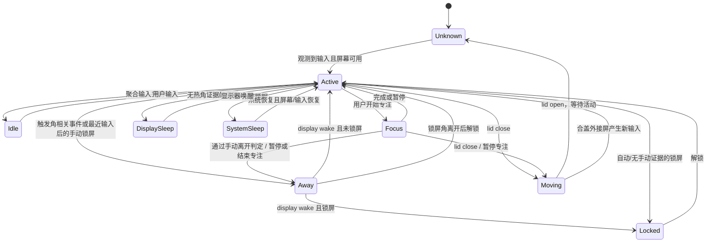

# 架构与系统接口

## 组件边界

```text
Sources/
  App/
    WorkRhythmApp.swift        AppKit 生命周期、单实例锁、菜单栏和原生窗口
    SystemMonitor.swift        NSWorkspace / NSEvent / IOKit / 分布式通知适配
    AppController.swift        串行编排、提醒、通知、登录项、导出与 UI 发布
    Views.swift                菜单栏、首页
    TimelinePage.swift         每小时色块、小时选择、倒序明细
    HydrationBottleView.swift  水瓶/花园矢量图缓存、Core Animation、可见性与能耗策略
    DrinkCard.swift            紧凑饮品容量输入、主题切换、配方图鉴
    HistoryAndSettings.swift   历史图表、设置、诊断
  Core/
    Models.swift               类型化状态、区间、专注片段、设置与事件
    WorkstationStateMachine.swift  不依赖 UI/IOKit 的纯状态归约器
    SessionLedger.swift        区间生命周期与专注暂停/恢复
    Repository.swift          SQLite schema、事务、备份、持久化
    StatisticsService.swift    日历切分、统计、CSV、纯提醒决策
    HydrationPlan.swift        饮水计划、每次建议量、当日水量与旧记录兼容
    DrinkGarden.swift          确定性日配方、原料汇总、花型/水色标识
    RuntimeBudget.swift        心跳、持久化期限与动画帧率预算
    DayActivity.swift          时间边界合并、互斥状态、小时切片、倒序查询
    DayTimelineSnapshot.swift  当日数据、预计算离开间隔、最多 4 天的 LRU 缓存
Tests/
  StateAndDataTests.swift      可重复的事件顺序与持久化测试
    HydrationTests.swift         旧数据兼容、水量、撤销、跨日与导出测试
```

SystemMonitor 的系统回调进入主队列，统一转换为 `Input`。状态机不读数据库、不发通知、不依赖 View。`Transition` 带事件原始时间、原因、置信度和重分类标志；SessionLedger 在 SQLite 事务内关闭/开启区间。Controller 才负责驱动计时器、通知与 ObservableObject。

## 状态与设备维度



`displayAwake`、`sleeping`、`lidClosed`、`locked`、`screenSaver` 独立保存。状态优先级需要结合已建立的行为：例如用户已经 Away 2 分钟后设备自动睡眠，人的 Away 不应被切成普通系统睡眠；system wake 也不代表人回来了。

`Focus` 属于在工位状态，专注记录与 Work 区间可重叠。`Idle` 只是输入沉默，不视为 Away。Unknown 明确表达离线/崩溃等无法观测区间。

## 为什么选这些系统机制

| 机制 | 本项目用途 | 可知与不可知 |
|---|---|---|
| NSWorkspace screensDidSleep / screensDidWake | 屏幕睡眠/唤醒边界 | 不含触发来源，不承诺逐显示器来源 |
| NSWorkspace willSleep / didWake | 系统睡眠与维护性唤醒 | 不直接等价于人的离开/返回 |
| IOKit IOPMrootDomain general interest | AppleClamshellState 变化 | 可观察合盖，不证明位置变化 |
| NSEvent global + local monitor | 角落进入边界与新鼠标活动 | 不拦截事件；不注册键盘文本 |
| CGEventSource idle seconds | 聚合空闲时长 | 不知道阅读/视频/会议等意图 |
| NSScreen | 全局点坐标、显示器拓扑 | 处理负坐标、缩放比例和热插拔；拓扑变化清除旧候选 |
| Dock CFPreferences | 尝试读取角动作与修饰键 | 具体配置键是未文档化实现细节，可退回手选 |
| DistributedNotificationCenter | 锁屏/解锁返回信号、屏保排除 | 不提供锁屏入口；具体通知名不是稳定公开 API |
| CGSessionCopyCurrentDictionary | 启动时锁屏状态辅助快照 | `CGSSessionScreenIsLocked` 键未文档化 |
| Unified Logging | 可选的开发诊断输出 | 不运行常驻日志查询、不把日志文案当主判定依据 |
| CGEvent tap | 不使用 | 无需监听键值/拦截输入，避免额外 TCC 权限与事件 tap 故障 |
| IOPM power assertions | 不使用 | 不阻止 Mac 正常睡眠，不以保持唤醒换取观测 |

IOKit SDK 中 `kIOPMMessageClamshellStateChange` 的注释明确表示它经 IOPMrootDomain 的 general interest 送达，并且若该变化导致睡眠，睡眠随后发生。本实现注册 root general interest，再读取最新 clamshell 属性；启动和 workspace sleep/wake 时也交叉读取，减少通知时序差异。

## 事件判定与顺序

- 候选只能从显示器亮、未锁屏、未屏保、未合盖、未系统睡眠的在工位状态产生。
- 只在进入角的边界生成一次候选，停留不延长有效期；离开角立即清除。
- 自动模式接受 Dock 中显示器睡眠动作 10、锁屏动作 13 的角，检查修饰键位掩码。两者按用户定义都代表离开，但原始事件保留差别。
- 锁屏或息屏时需要 `0 ≤ uptime差 ≤ window`、仍在角、输入空闲 ≤ window + 0.5。
- 候选通过后等待 1.25 秒的事件聚合；保留最早满足条件的锁屏或息屏原始时间。
- pending 时合盖/系统睡眠取消 Away。普通屏保取消候选；若锁屏已先建立手动候选，随后出现的锁屏界面屏保通知不取消。
- `lockObserved` 携带单调时间、聚合空闲秒数与位置快照。新鲜触发角候选以 0.85 置信度推断 Away；没有角落证据但空闲不超过 5 秒时，以 0.75 置信度推断快捷键、Apple 菜单或其他手动锁屏。超过 5 秒、屏保先发生或存在合盖/系统睡眠时仍归设备锁屏。
- `sessionDidResignActive` 可能早于详细分布式通知，也可能代表快速用户切换。监视器延迟 50 ms 后检查会话锁定快照；状态机允许无来源 `lock` 先到后，被后续 `lockObserved` 升级为 Away。
- 只锁屏不息屏也能建立 Away，解锁提交 pending 并结束；确实发生屏幕睡眠后可在 display wake 结束。屏幕始终亮着时重复 wake 不视为返回。
- 重复 lock/sleep 不重复建记录；快速 unlock/wake 会提交 pending 后立即结束，以免短休丢失。
- 已提交 Away 的前 3 秒若出现系统睡眠竞争信号，记录重归类为 DisplaySleep 后进入 SystemSleep。
- 监视器对鼠标活动的节流不影响角落边界检查；只对普通 activity 发布做节流，角落事件逐次处理。

这些条件不能数学上证明来源。若用户移动鼠标到角落的同时，另一个进程触发息屏，事件证据仍可能完全一致。因此不输出 100% 置信度，也不把代码测试的通过率作为硬件识别准确率。

## SQLite 与故障边界

schema v1：

| 表 | 行类型 |
|---|---|
| sessions | `Session`，kind 区分 work/away/moving/idle/systemSleep/displaySleep/locked/unknown |
| focus | `FocusSession`，包含分段专注、计划时长、暂停时长、完成/中断 |
| hydration | `HydrationEvent` |
| events | `SystemEvent` |
| preferences | 设置与持久化 checkpoint |

每行有 id、start 索引值和版本内 Codable JSON payload。kind 使 Work/Away/Move 共用同一事务区间实现，避免不同管理器产生互相冲突的开放状态。日汇总按需重算，不保存会过期或跨时区失真的 DailySummary 副本。

1.2 使用可选 Codable 字段扩展现有 schema：设置增加 `hydrationPlan`，旧设置没有这个键时使用默认计划；HydrationEvent 增加 `amountML` 与 `voidedAt`，旧记录解码为 nil，不假定历史水量。每条新饮水记录保存点击时的实际每次量。撤销写入 voidedAt 后再更新内存，保证写入失败时 UI 不显示虚假成功；统计只使用未撤销记录。在线备份仍包含所有记录。

1.3 在 HydrationPlan 增加可选 `themeID` 和 `ambientMotion`。缺失或未知主题回退水瓶，缺失动画偏好默认为开启。主题切换只更新设置，绝不写入饮水事件。水瓶、花园、爬山虎均由 `HydrationProgress.fraction` 驱动，撤销与跨日自然同步。

1.6 在 HydrationPlan 增加可选 `presetVolumesML` 字典，以稳定的 DrinkPreset rawValue 为键；缺失项使用默认示例容量。HydrationEvent 增加可选 `drinkPresetID`，仍保存实际 amountML。普通图案点击、通知与快捷项均经过 Controller.drink → Ledger.drink 路径，数据库提交成功后才显示反馈；preset 仅选择容量与类型，不改变时间线、统计或提醒口径。旧记录不补造饮品类型，未知类型显示“饮水”且原始值可导出。CSV 末尾新增 drink_preset，全部行保持一致列数。

1.7 的主菜单取消 ScrollView，默认 300×440，小尺寸模式压缩插图、隐藏概览指标；专注其他时长、提醒详情与配方图鉴按需打开。DrinkCard 的类型和容量保存在视图编辑状态中，只有提交时调用 `drink(preset:amountML:)`；Controller 在实际记录保存成功后更新各饮品 `presetVolumesML` 及可选 `lastDrinkPresetID`。非法输入不记账。旧配置仍可解码，`themeID=ivy` 映射为 flowers；移除 ivy 的展示与渲染分支。

1.8 增加稳定类型 `tea` / `milk`，展示次序由 displayOrder 指定。DrinkCard 使用原生离散 Slider，step=150，range=150...600，刻度按钮与滑杆共用 amount 状态；切换类型只修改 selection。提交统一经过 recordSliderDrink 的四档校验，不允许越界或中间值。旧实际数据依然可解码，旧偏好只在初始化滑杆时经 sliderValue 映射，不重写历史。原图案快捷点击入口移除，通知和历史低层数据接口保留原量程。

1.1.0 的 `GardenTrophy` 是独立持久化快照，记录日期、获得时间、花型、达成水量与当时目标。当天首次达到目标时创建，同日后续饮品只升级该奖杯的花型和最高水量，不重复计数；撤销不会回收已获得奖杯。schema 2 新增 `garden_trophies` 表，首次启动按当前目标为符合条件的旧饮水日期补录一次，之后修改计划不会改变奖杯保存的目标。统计页月历只读取奖杯快照，不在渲染时反复扫描全部饮水历史。

1.0.0 公开版扩展手动锁屏来源：触发角继续保留更强的鼠标相关证据；快捷键/菜单使用 `CGEventSource.secondsSinceLastEventType` 的最近任意输入时间，不注册键盘事件或读取键值。5 秒窗口用于区分典型即时手动操作与长空闲自动锁屏，但无法证明具体入口，企业策略即时锁定等边界可能误判，因此来源和置信度进入 Session trigger。

配方增加铃兰、百合、兰花与大丽花的独立矢量绘制及四色；既有 rainbow 的原料显式固定为原四种，不因枚举增项改变旧组合。渲染仍沿用 recipe 缓存键和 Core Animation，不为滑杆或新配方增加常驻计时器。

`HydrationProgress` 先按本地日期过滤，再用 `DrinkGarden` 汇总未撤销且水量已知的各类型。普通旧水记录参与清水配方，未知未来类型不猜测原料。配方根据类型集合、相关体积、固定顺序确定，数据不额外持久化；因此撤销、重启和跨日不会出现幽灵解锁。每日总量仍决定长高和花瓣展开，配方决定雏菊/向日葵/郁金香/波斯菊/金盏花/玫瑰/彩虹花的形状与水色。相同量但配方变化时，CALayer 缓存键也随 recipe 变化，仅重新生成有限插图图层，不增加逐帧 SwiftUI 计算。图鉴可以预览未点亮配方，点击图鉴不记录饮品。

1.4 的 `HydrationArtwork` 以 Canvas 定义底图、水和各植物的矢量部分；`HydrationLayerView` 仅在主题、水量、尺寸、屏幕缩放变化时用 ImageRenderer 生成透明图层内容。水在瓶形遮罩内平移，各植物围绕根部轻摆，Core Animation 负责持续合成，应用不再逐帧执行 Canvas。插图缓存归所属 NSView 所有，拆除即释放；主题变化替换原有图层。`AnimationEnergyPolicy` 通过电源/温度通知发布 12/6/0 fps 预算，无新增轮询，帧率请求最终由系统调度。

`SceneVisibilityProbe` 通过 NSView/NSWindow 可视区域、窗口 occlusion 通知、滚动位置通知与 workspace 屏幕睡眠通知决定是否安装动画；观察器随视图拆除。窗口不可见、系统 Reduce Motion 或用户关闭动画时移除动画，保留静态画面。桥接 NSView 初次检查也必须发布 false，否则 SwiftUI 保留的 true 状态会使隐藏卡片继续动画。菜单关闭时清空 hosting controller，主窗口关闭时释放窗口内容。原生验证比较 presentation layer，不以静态 model layer 快照判断动画是否在运行。

Controller 的日统计缓存以当天起点为键，最多 64 项；now、revision 或 settings 变化时清空。秒级状态栏倒计时只计算专注剩余时间，不访问日统计。心跳在亮屏未锁定时为 15 秒、锁屏/息屏时为 30 秒、系统睡眠时取消；下一次检查按持久化期限对齐，容差 2 秒。角落匹配目标按屏幕拓扑与设置预计算，鼠标回调不再重复构造几何。历史 session/focus/hydration 数组仍全量加载，长年大量数据的分页是后续优化边界。

WAL + synchronous FULL 保证已提交边界的持久化；最后一次 heartbeat 到进程终止之间的尾部观测无法保证完整。数据写入失败会在 UI 显示错误，不能把这种运行状态视为记录成功。

单实例文件锁防止直接执行二进制产生两个监听器或重复记账。SQLite backup API 导出的主库包含当前已提交 WAL，不要求用户手工拼接文件。

## 每日时间分布（1.5）

`DayActivity` 先按所选本地日期与当前时间裁切记录，将状态起止点排序，扫描生成互不重叠的连续色块。同一时刻优先采用离开、合盖、设备不可用，其次为专注、静默、普通在工位；专注只读取有效 segments，不用整个计划区间填色。未观测到的过去时间为未记录，未来不生成片段。接着按 Calendar 的真实小时边界切片，支持夏令时 23/25 小时及重复小时的独立身份。

图表每列一小时，竖向位置保留真实分钟位置，不将不同状态简单聚拢相加。选择小时后仅查询与其相交的记录；全天明细折叠，按 start 倒序懒加载。离开间隔查找时间上更早的记录，不依赖当前显示排序。图表没有独立计时器或持续动画，使用既有 Controller 的状态/时间更新。

`render_preview.py` 从临时源码快照编译 UI 检查，避免构建过程中编辑文件导致编译输入改变。临时测试数据只写隔离数据库。

1.5.1 的日快照缓存由 Ledger 的 session/focus 修改版本控制：标签、状态、专注修改全部失效；普通时间刷新只替换未结束日期。键包含 Calendar 及裁切到日边界的观测上界，兼容时区和时间回拨。快照只保留当日数据，明细过滤不再访问全历史；同日离开间隔在构建快照时计算，逐行按 ID 查表。小时切片改用顺序游标。缓存仅在请求时构建，无后台预热线程。

诊断页的最近 500 条事件使用独立快照：Repository 成功写入日志或实际删除日志时更新 eventRevision，Controller 下次读取时刷新；显式“刷新”强制失效，筛选文本不触发数据库读取。用户用其他工具直接编辑数据库后需要点击刷新。`Tools/timeline_benchmark.py` 编译 1.5 基线与当前代码，顺序运行模拟历史数据基准并校验两版计算一致。

## 提醒决策

提醒策略是可单测的 `ReminderPolicy`，在设备可用且在工位时评估。返回后默认等 120 秒；同一类别通知最少间隔 30 分钟以减少重复。喝水 Snooze 明确设置 15 分钟的新到期时间。

Focus 使用有效片段累计；pause 关闭片段，resume 开新片段，completion 在剩余有效时间的单次 Timer 上触发。只有 UI 可见的秒级倒计时持续刷新，没有每秒查询 IOKit 的逻辑。

当前 Snooze 与 Ignore 是进程内状态，重启后重新按最后喝水和新工作区间计算；这项限制在 README 中说明。

## 接口证据

实际查阅于 2026-10-13：

- Apple [Monitoring Events](https://developer.apple.com/library/archive/documentation/Cocoa/Conceptual/EventOverview/MonitoringEvents/MonitoringEvents.html)：全局/本地事件监视器范围互补；键盘全局监听需要辅助功能授权，回调在主线程。
- Apple [screensDidSleepNotification](https://developer.apple.com/documentation/appkit/nsworkspace/screensdidsleepnotification)：仅声明屏幕进入睡眠，未提供热角来源字段。
- Apple [willSleepNotification](https://developer.apple.com/documentation/appkit/nsworkspace/willsleepnotification)：workspace 的系统睡眠通知，无 userInfo 来源字典。
- Apple [Use hot corners](https://support.apple.com/en-euro/guide/mac-help/mchlp3000/mac)：角动作和修饰键的用户设置方式。
- Apple Developer Forums [Sleep state notification inconsistencies](https://developer.apple.com/forums/thread/796109)：设备/外接显示器/电源条件下的通知组合差异。论坛为实机问题报告，不当作 API 保证。
- 本机 Xcode SDK `IOKit.framework/Headers/pwr_mgt/IOPM.h`，AppleClamshellState 与 kIOPMMessageClamshellStateChange 注释（约 200–217、426–440 行）。

未发现足够证据把 Unified Logging 某条日志、Dock 内部通知或私有 WindowServer API 当作稳定公开的热角触发事件。V1 不采用这些方式。
