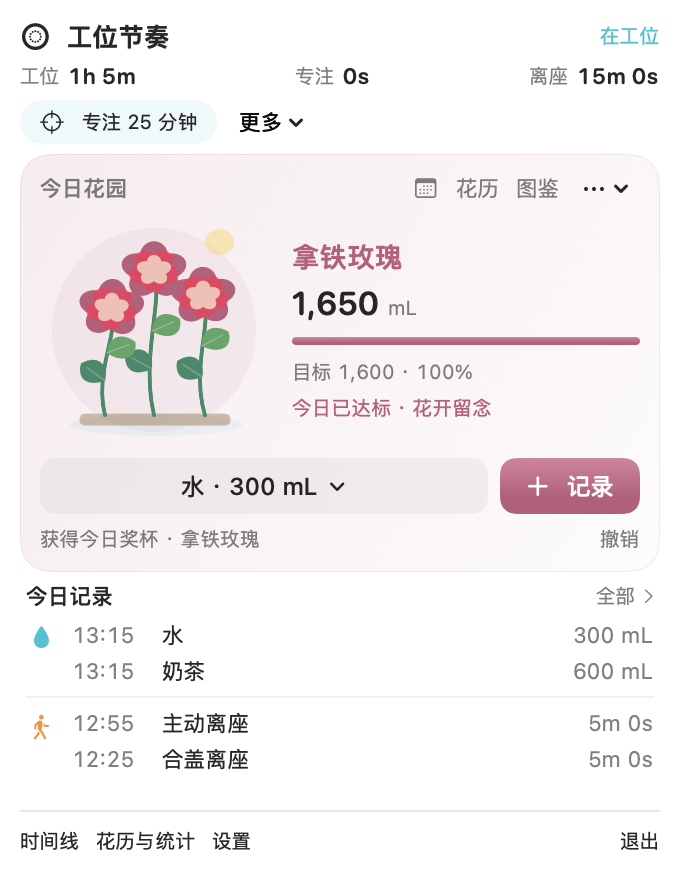

# WorkRhythm · 工位节奏

原生、离线优先的 macOS 菜单栏工具，用时间线记录工作、专注、主动短暂离开、合盖和设备不可用状态，并提供番茄钟、喝水花园和健康提醒。



> WorkRhythm 不是位置传感器，也不评价工作效率。状态来自系统事件和启发式规则，可能存在误判。

## 功能

- **工作节奏时间线**：按小时色块展示 Work、Focus、Idle、Away、Moving、Locked/Sleep 和 Unknown。
- **离座识别**：
  - 锁屏或息屏触发角：关联鼠标进入角落与后续系统事件。
  - `⌃⌘Q`、Apple 菜单锁屏等：锁屏前 5 秒内有聚合用户输入时，推断为手动锁屏。
  - 锁屏与合盖都计为离座，并保留“锁屏离座 / 合盖离座”类型；解锁和开盖只结束离座，不重复计次。
  - 自然息屏、系统睡眠和屏保不计为离座。
- **番茄钟**：Away、合盖、锁屏和睡眠时暂停或结束，返回后手动继续。
- **喝水花园**：六类饮品、150–600 mL 离散滑杆、12 种花型与水色配方，以及达标开花奖杯月历。
- **紧凑花园面板**：放大花朵、记忆上次饮品与容量，一键记录；点击饮品展开选择面板，确认后才保存。
- **饮水与离座记录**：菜单直接显示最近的饮水和离座时间；“全部”可按日期查看主动离座、锁屏离座与合盖离座及其持续时长。
- **本地数据**：SQLite 持久化、在线备份、CSV 导出、崩溃恢复和跨午夜统计。
- **低资源占用**：事件驱动监听；隐藏界面停止动画，锁屏降频，系统睡眠停止心跳。


## 系统要求

- macOS 14 或更高版本
- Apple Silicon 或 Intel Mac
- 从源码构建需要 Xcode 15 或更高版本

不需要辅助功能、输入监控、屏幕录制或自动化权限。通知和登录启动均可选。

## 安装

### GitHub Release

从 [Releases](../../releases/latest) 下载 `WorkRhythm-v1.0.0-macOS-universal.zip`，解压后将 `WorkRhythm.app` 移入 `/Applications`。

当前公开二进制使用 **ad-hoc 签名且未经过 Apple 公证**。首次打开可能需要在 Finder 中右键 App →“打开”并确认。不要关闭 Gatekeeper 或 SIP。

### 从源码构建

```bash
git clone https://github.com/ulysseszzz/WorkRhythm.git
cd WorkRhythm
swift test
python3 Tools/generate_project.py
xcodebuild -project WorkRhythm.xcodeproj -scheme WorkRhythm \
  -configuration Release \
  -derivedDataPath /tmp/WorkRhythm-DerivedData build
open /tmp/WorkRhythm-DerivedData/Build/Products/Release/WorkRhythm.app
```

也可直接打开 `WorkRhythm.xcodeproj`，选择 `WorkRhythm` scheme 和 `My Mac`。

## 手动锁屏判定

macOS 没有公开 API 告诉应用“用户通过哪个入口锁屏”。WorkRhythm 使用以下可解释规则：

1. **触发角**：锁屏/息屏事件发生在进入已配置角落后的检测窗口内，且鼠标仍在角落，记录为 Away。
2. **快捷键或菜单**：锁屏事件发生时，系统报告最近聚合输入不超过 5 秒，记录为 Away。
3. **自动事件**：长时间无输入、屏保先启动、系统睡眠或合盖，不记录为 Away。
4. **竞争事件**：锁屏后 3 秒内收到系统睡眠或合盖，重新归类为设备事件。

快捷键/菜单识别不读取按键内容，只读取系统提供的“距最近任意输入的秒数”。5 秒窗口是启发式阈值，不是来源证明；企业策略即时锁屏等少数情况仍可能被误判。

## 隐私

- 数据仅保存在本机，不联网、不上传，不含分析或广告 SDK。
- 不读取键盘内容、前台 App、浏览记录、剪贴板或屏幕图像。
- 鼠标监听只用于判断是否进入触发角，不保存连续轨迹。
- 诊断日志可能包含时间和角落坐标，导出前请自行检查。

完整说明见 [PRIVACY.md](PRIVACY.md)。

## 数据位置

```text
~/Library/Application Support/WorkRhythm/workrhythm.sqlite
~/Library/Application Support/WorkRhythm/workrhythm.sqlite-wal
~/Library/Application Support/WorkRhythm/workrhythm.sqlite-shm
```

请通过 App 内“备份数据”创建一致性备份，不要在运行中单独复制主数据库。

## 验证与限制

```bash
swift test --scratch-path /tmp/WorkRhythm-tests
Tools/package_release.sh
```

核心状态机、数据库、时间线和饮水配方有自动测试。触发角、真实快捷键锁屏、合盖、外接显示器和通知仍受具体硬件与 macOS 版本影响，自动测试不能替代实机验收。

- [验证记录](VALIDATION.md)
- [架构说明](ARCHITECTURE.md)
- [性能方法与边界](PERFORMANCE.md)
- [安装说明](INSTALL.md)
- [变更日志](CHANGELOG.md)

## 参与贡献

请先阅读 [CONTRIBUTING.md](CONTRIBUTING.md)、[CODE_OF_CONDUCT.md](CODE_OF_CONDUCT.md) 和 [SECURITY.md](SECURITY.md)。

## License

[MIT](LICENSE)
